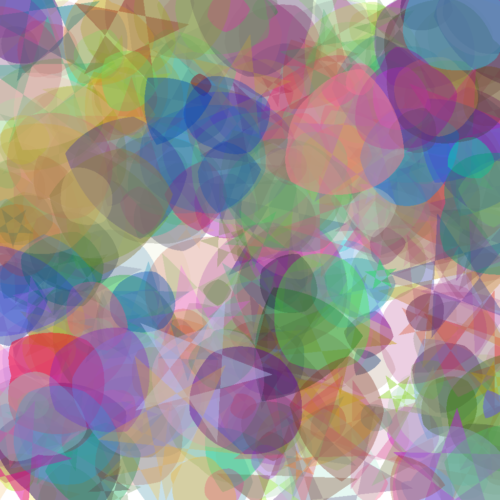

# disk-tree

Point stabbing in Zig: given n shapes in the plane, report every shape that
contains a query point in O(log n + k) time for k reported shapes, or combine a
value over all of them in O(log n) without visiting them.

The shapes can be disks or closed paths of cubic Béziers.

```zig
const stab = @import("disk_tree");

var tree = try stab.DiskTree.init(gpa, &.{
    .{ .cx = 0, .cy = 0, .r = 2 },
    .{ .cx = 1, .cy = 0.5, .r = 1 },
});
defer tree.deinit(gpa);

const ids = try tree.query(gpa, 0.5, 0.2); // { 0, 1 }
defer gpa.free(ids);
```

`queryAppend` does the same into a list you already have.

## Paths

`PathTree` takes shapes outlined by cubic Béziers. A shape is one or more closed
contours filled by the even-odd rule, so it can be concave, have holes, or cross
itself. A straight edge is a cubic with its control points on the line.

```zig
var tree = try stab.PathTree.init(gpa, &.{
    .{ .curves = outline },
    .{ .curves = shape.curves.items, .offset = shape.offset }, // a ConvexBezierShape
});
defer tree.deinit(gpa);

const ids = try tree.query(gpa, x, y);
```

## Folding without visiting

`Folded(T, combine)` for disks and `FoldedPaths(T, combine)` for paths attach a
value to every shape and return the values of all shapes over a point already
combined, in O(log n) no matter how many shapes that is. `combine` must be
associative but need not be commutative: it sees the shapes in index order.

Counting the disks over a point:

```zig
fn add(a: u32, b: u32) u32 {
    return a + b;
}

var tree = try stab.Folded(u32, add).init(gpa, circles, ones);
const depth = tree.fold(x, y) orelse 0;
```

With shapes listed back to front, premultiplied colours and the "over" operator,
`fold` is the finished pixel. `zig build render -- disks out.ppm` and
`zig build render -- paths out.ppm` draw translucent shapes that way, one lookup
per pixel:




A bounding volume hierarchy has to visit every shape over the point to do this.
The price here is memory that grows with the number of crossings, so it pays off
when the overlap is deep, the values are constant per shape, the scene is
static, and the queries are not coherent enough to sweep directly.

## How it works

Every shape is described by the x-monotone arcs of its boundary: a circle has a
lower and an upper arc, and a path is cut wherever it turns back in x. Sweep a
vertical line across the plane. The arcs it cuts have an order by y, and between
two neighbouring arcs lies one face of the arrangement, covered by the same
shapes everywhere. Crossing an arc upwards toggles that arc's shape, so a point
is inside a shape when an odd number of its arcs lie below.

The order only changes at an event: arcs start, arcs end, or two arcs cross. So
the x axis splits into slabs with a fixed order each, and neighbouring slabs
differ by a small edit:

- a start inserts two arcs,
- an end removes two arcs,
- a crossing swaps two neighbouring arcs, which changes the face between them
  by one shape.

The arcs are kept in a treap ordered by y, and each arc stores the set of shapes
covering the face above it, with the combined value of each subtree kept in its
nodes. Both are persistent, so every slab keeps its own version at O(log n)
extra cost instead of a full copy. Treap nodes hold one timestamped override
before they are copied (Driscoll et al.), and the sets are path-copied treaps.

A query binary searches the slabs by x, walks that slab's treap by y, and reads
the set stored on the arc just below the point.

With c crossings between arcs, building takes O((n + c) log n) time and space
after finding the crossings. c can be quadratic, when every shape crosses every
other, so this suits inputs where each shape overlaps a bounded number of
others.

`src/sweep.zig` holds the structure and knows nothing about the shapes;
`src/disk_tree.zig` and `src/path_tree.zig` describe disks and paths to it. A
new kind of shape needs its arcs, their heights, and where they may cross.

### Floating point

Crossing coordinates are computed in floating point, so the sweep does not trust
them to say what the order is. Events only mark arcs as possibly out of place.
The order itself comes from comparing those arcs with their neighbours at the
middle of the next slab, and every swap that comparison causes updates the face
sets. Several boundaries through one point, tangencies, shared edges and
duplicate shapes need no special cases in the sweep.

For paths, crossings are found by subdividing pairs of curve pieces until their
gap is monotone, then solving for the root. Two cases produce an order change
without a root and get hints of their own: a vertical edge, which makes an arc
jump, and curves that leave a common point along the same tangent, which cannot
be told apart until they have separated.

A query point within rounding error of a boundary may be reported either way
for that shape.

## The slab tree

`src/stabbing`, `src/geometry` and `src/math` hold the earlier structure for
convex Bézier shapes from `circle_renderer`: `StabbingTree` keeps the active
shapes of every slab and a segment tree over their y-extents, and
`PackedTreeData` flattens it for a GPU. It works in `f32`, and stores each
slab's shapes outright rather than sharing them between slabs, so memory grows
with slabs times shapes per slab. `PathTree` answers the same queries exactly
and handles shapes that are not convex.

## Build

Needs Zig 0.16.

```sh
zig build test
zig build bench
```

## Benchmark

Random shapes in a 1000 x 1000 square, 200,000 random queries, on an Apple M1
Pro. "hits" is the average number of shapes over a query point, "query" lists
them, "fold" counts them, and "scan" tests every shape.

Disks:

| disks     | hits  | slabs     | build  | memory  | query   | fold    | scan    |
|-----------|-------|-----------|--------|---------|---------|---------|---------|
| 1,000     | 1.2   | 5,722     | 2 ms   | 0.6 MiB | 0.26 µs | 0.24 µs | 0.45 µs |
| 1,000     | 11.3  | 37,490    | 16 ms  | 5.1 MiB | 0.56 µs | 0.36 µs | 0.45 µs |
| 1,000     | 95.9  | 260,674   | 0.14 s | 50 MiB  | 3.1 µs  | 0.75 µs | 0.45 µs |
| 10,000    | 1.2   | 56,820    | 26 ms  | 5.8 MiB | 0.44 µs | 0.42 µs | 4.4 µs  |
| 10,000    | 11.6  | 390,748   | 0.19 s | 53 MiB  | 1.7 µs  | 1.1 µs  | 4.4 µs  |
| 10,000    | 108.0 | 3,345,438 | 2.2 s  | 673 MiB | 6.8 µs  | 2.2 µs  | 4.4 µs  |
| 100,000   | 1.2   | 578,216   | 0.31 s | 60 MiB  | 1.7 µs  | 1.5 µs  | 44 µs   |
| 100,000   | 11.8  | 4,041,312 | 2.4 s  | 554 MiB | 3.6 µs  | 2.6 µs  | 44 µs   |
| 1,000,000 | 1.2   | 5,800,312 | 3.8 s  | 599 MiB | 3.9 µs  | 3.6 µs  | 475 µs  |

Convex Bézier shapes of three to eight curves, with the slab tree alongside:

| shapes  | hits | slabs     | build  | memory  | query   | fold    | scan    | slab tree build | slab tree query |
|---------|------|-----------|--------|---------|---------|---------|---------|-----------------|-----------------|
| 1,000   | 0.7  | 4,815     | 8 ms   | 1.3 MiB | 0.31 µs | 0.30 µs | 7.6 µs  | 6 ms            | 0.53 µs         |
| 1,000   | 7.3  | 25,861    | 45 ms  | 4.1 MiB | 0.69 µs | 0.60 µs | 14 µs   | 19 ms           | 2.5 µs          |
| 10,000  | 0.7  | 48,043    | 75 ms  | 13 MiB  | 0.58 µs | 0.58 µs | 63 µs   | 30 ms           | 0.78 µs         |
| 10,000  | 7.5  | 274,050   | 0.50 s | 44 MiB  | 1.8 µs  | 1.5 µs  | 82 µs   | 99 ms           | 3.3 µs          |
| 100,000 | 0.7  | 482,682   | 0.83 s | 136 MiB | 2.4 µs  | 2.2 µs  | 1.9 ms  |                 |                 |
| 100,000 | 7.5  | 2,774,234 | 5.1 s  | 441 MiB | 3.8 µs  | 3.5 µs  | 1.7 ms  |                 |                 |

The number of slabs grows with shapes times hits squared, and memory is 100 to
200 bytes per slab, so deep overlap is expensive to store. Query time on large
inputs is dominated by cache misses on the walk down the treap; a thousand disks
are still quicker to scan. The benchmark skips the slab tree at 100,000 shapes,
because its per-slab lists grow with slabs times shapes per slab.

## References

- Sarnak and Tarjan, "Planar point location using persistent search trees", 1986
- Driscoll, Sarnak, Sleator and Tarjan, "Making data structures persistent", 1989
